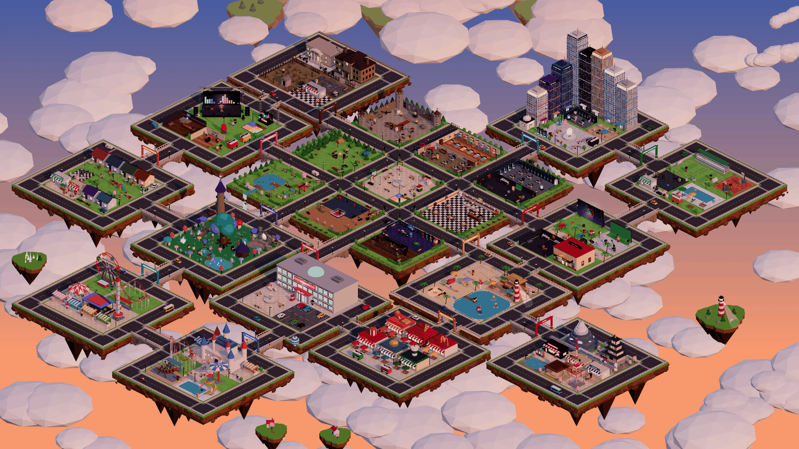

# Pueblo Agéntico

Wallpaper animado para [Wallpaper Engine](https://www.wallpaperengine.io/): un archipiélago isométrico voxel con 14 zonas y 191 personajes que comen, duermen, trabajan, se saludan, discuten y charlan entre ellos con una IA local.



## Qué tiene

- **14 zonas unidas por puentes**: Pueblo Central, Distrito Tecnológico, Ciudad del Cine, Isla Festival, Bosque Mágico, Parque Deportivo, Barrio Residencial, Raccoon City, Playa del Sol, Mega Mall, Avenida de la Comida, Parque de Diversiones, Japón y Súper Parque.
- **Personajes con vida propia**: necesidades, gustos, relaciones y memoria. Se chocan las manos, se abrazan, se cuentan secretos, se toman selfies, se hacen regalos, se consuelan, discuten y se baten a duelo según cómo se lleven.
- **IA local con Ollama**: gratis y sin internet. Si está apagada, el pueblo sigue con frases pregrabadas.
- **Editor de personajes**: crea vecinos nuevos o cambia los que ya existen, con vista previa 3D. Lo que guardas aparece al instante, y un botón lleva la cámara hasta ese personaje.
- **Buscador**: encuentra a cualquier vecino con el mouse y la cámara va hasta donde está.
- **Clima, estaciones y eventos**: lluvia, nieve, Halloween, Navidad, conciertos y más, según la fecha real.

## Instalación

Necesitas Windows, Wallpaper Engine, [Node.js](https://nodejs.org/) y, para la IA, [Ollama](https://ollama.com/).

```powershell
git clone https://github.com/TicSide/pueblo-agentico.git
cd pueblo-agentico
powershell -ExecutionPolicy Bypass -File .\instalar.ps1 -Aplicar
```

`instalar.ps1` instala las dependencias, enlaza el wallpaper en Wallpaper Engine, crea los atajos y hace que el cerebro arranque con Windows. Si Wallpaper Engine está en otra biblioteca de Steam, agrega `-RutaWE "D:\ruta\wallpaper_engine"`.

Para la IA, instala Ollama y descarga el modelo indicado en `cerebro/config.json`. Sin Ollama, el pueblo funciona con frases pregrabadas.

## Cómo se usa

| Acción | Cómo |
| --- | --- |
| Ver la ficha de un vecino | Clic sobre él |
| Seguirlo con la cámara | Doble clic |
| Buscar a un vecino | Botón de la lupa |
| Crear o editar personajes | Botón del lápiz, `Ctrl+Alt+E` o http://127.0.0.1:8787/editor |
| Hablarle al pueblo | `Ctrl+Alt+H` |
| Cambiar la interfaz | Botón del engranaje |

Wallpaper Engine no pasa el teclado a los wallpapers. Por eso el editor se abre en el navegador y el buscador funciona solo con el mouse.

## Estructura

- `wallpaper/`: el wallpaper (HTML, three.js y JavaScript sin compilar) y el editor (`editor.html`).
- `cerebro/`: servidor local en Node: simulación, conexión con Ollama, memoria del pueblo y guardado del editor.
- `wallpaper/js/personalizados.js`: los personajes que creas o cambias con el editor. Lo escribe el cerebro.
- `cerebro/datos/`: memoria del pueblo en tu PC. No se sube al repositorio.
- `wallpaper/fotos/`: fotos opcionales para las fichas. No se incluyen: cada quien pone las suyas.

Más detalle en [docs/ARQUITECTURA.md](docs/ARQUITECTURA.md). Para revisar los datos después de cambiarlos, ejecuta `npm test` en `cerebro/`.

## Aviso

Es un proyecto personal de fans, sin fines comerciales y sin relación con las empresas o franquicias que aparecen. Los personajes, marcas y logos pertenecen a sus dueños.
